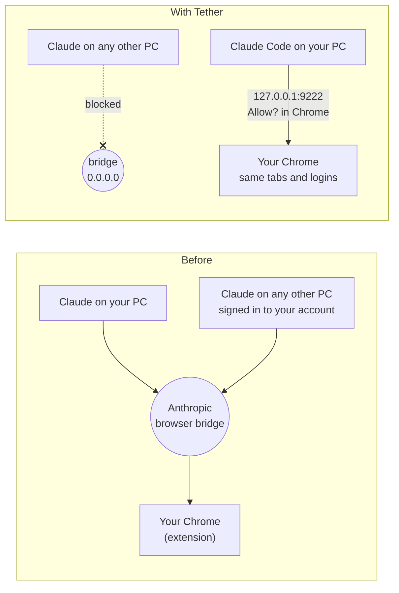

<div align="center">


<h1>Tether</h1>

**Keep Claude's control of your Chrome on this computer only.**

Any Claude session signed in to your account, on any computer, can drive the Chrome where the Claude extension is signed in. Tether closes that door and gives Claude Code a local-only one, with the same browser, the same tabs and the same logins.

[](https://github.com/shakaibarsalan/tether/actions/workflows/test.yml)
[](LICENSE)


▶ [**Watch the 20-second guide**](video/tether-guide.mp4)

</div>

---

## The problem

The Claude in Chrome extension takes its commands from Anthropic's hosted browser bridge. The bridge addresses browsers by **account**:

- `list_connected_browsers` shows every Chrome on your account, on every computer.
- `select_browser` picks any of them by ID, and **nothing appears in that browser**.

So if your account is signed in anywhere else (an office PC, an old laptop you never signed out of, or someone who has your login), a Claude session there can open tabs in *your* Chrome, with your Gmail, your banking and your client dashboards logged in. It also works the other way: your Claude can wander into a browser that isn't yours.

You can't fix this from inside the extension. We measured it: even Claude on the **same** computer talks to the extension through the bridge ([details](docs/how-it-works.md)). There's one door, and the account opens it.

## What Tether does

| | |
|---|---|
| **Closes the remote door** | Points `bridge.claudeusercontent.com` at `0.0.0.0` in the Windows hosts file. No other computer can drive your Chrome, whatever account they use. |
| **Keeps your browser as it is** | The extension stays installed. Your profiles, tabs and logins are untouched. Nothing to re-login. |
| **Gives Claude Code a local door** | Installs Google's [chrome-devtools-mcp](https://github.com/ChromeDevTools/chrome-devtools-mcp) with `--autoConnect`. Claude Code drives your real Chrome over `127.0.0.1`, and Chrome asks **Allow?** for each new session. |
| **Works across accounts** | Everything lives on the computer, not the account. Switch Claude accounts as often as you like. |
| **Undoes cleanly** | One script to undo each part. Every change is backed up first. |
| **Optional guard** | If you keep the bridge open, a Claude Code hook stops *your* Claude from driving anyone else's browser. |

## How it works



What we measured, the version numbers and the open questions are in [docs/how-it-works.md](docs/how-it-works.md).

## Install

**You need:** Windows 10 or 11, Chrome 144+, [Node.js](https://nodejs.org) 20.19+, and [Claude Code](https://code.claude.com).

```powershell
git clone https://github.com/shakaibarsalan/tether
cd tether
powershell -NoProfile -ExecutionPolicy Bypass -File .\install.ps1
```

`install.ps1` does two things:

1. **DevTools setup.** It installs `chrome-devtools-mcp` (pinned to a version) and registers it in Claude Code as `chrome-devtools`.
2. **Bridge block.** It adds two lines to the hosts file. Windows asks for admin.

Then, once:

1. **Restart Chrome completely**, so the extension drops its bridge connection.
2. In Chrome, open `chrome://inspect/#remote-debugging` and tick **Allow remote debugging for this browser instance**.
3. Start a **new** Claude Code session. The first time it touches the browser, Chrome asks **Allow?**. Click Allow.

Prefer clicking? `Block-Remote.bat` and `Unblock-Remote.bat` do the bridge part on their own.

## Daily use

- Ask Claude Code to do browser work as usual. It uses the `chrome-devtools` tools on your real Chrome.
- **Leaving Claude to work on its own?** Ask it to connect first ("list my open tabs"), click **Allow**, then go.
- Check the block any time:
  ```powershell
  powershell -File .\scripts\bridge-block.ps1 -Status
  ```

## Undo

```powershell
powershell -NoProfile -ExecutionPolicy Bypass -File .\uninstall.ps1
```

This removes the DevTools server and the bridge block. You can also turn remote debugging off at `chrome://inspect/#remote-debugging`.

## Optional: the guard hook

If you'd rather keep the bridge open, so the extension works the old way, you can at least make sure *your* Claude Code only drives *your* browser:

```powershell
powershell -NoProfile -ExecutionPolicy Bypass -File .\scripts\guard-install.ps1 -DeviceId <your-browser-deviceId>
```

Ask Claude Code to run `list_connected_browsers` to find the ID. The guard:

- refuses every browser tool until the browser in use is confirmed as yours;
- always refuses `switch_browser`, which sends a Connect prompt to every browser on the account;
- fails closed if anything goes wrong.

There's a Python version (`hooks/chrome_browser_guard.py`) and a Windows PowerShell version, so Python isn't required. Remove it with `scripts\guard-uninstall.ps1`.

The guard protects other people from your Claude. **It doesn't stop other computers from driving your Chrome. Only the bridge block does that.**

## Limits

- **Windows only for now.** The same idea works on macOS and Linux (hosts file plus `--autoConnect`). PRs welcome.
- **Claude in Chrome stops working** while the bridge is blocked, for everyone including you. That's the point. Browser work moves to the DevTools tools.
- **Hooks and MCP servers are Claude Code features.** The Chat and Cowork tabs in the Claude app don't use them.
- **Chrome has to be running** for `--autoConnect`, and it asks **Allow?** once per new session.
- **A VPN or proxy that resolves DNS itself** can bypass the hosts file.
- **Anthropic can change how the extension connects.** If they add per-device approval, you may not need the block at all.

## Tests

```powershell
python -m unittest discover -s tests -v
```

38 tests. The same 13 rules run against both guards, plus the bridge block and the guard installer, always on temp copies, never your real hosts file or settings. CI runs them on `windows-latest`.

## License

[MIT](LICENSE). Not affiliated with Anthropic or Google.
